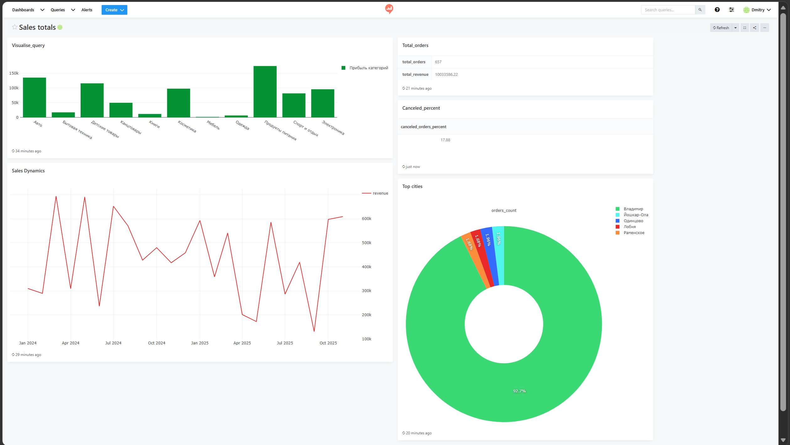

# Аналитический дашборд интернет-магазина

Интерактивный дашборд для анализа продаж интернет-магазина, 
построенный на стеке Redash + PostgreSQL + Docker.

## Ключевые инсайты

- **Топ-категория по выручке**: Продукты питания (150k+) - 
  низкий средний чек, но высокая частота покупок
- **Конверсия**: примерно 17% заказов отменено - требует анализа причин
- **Сезонность**: пик продаж в апреле и октябре 2025
- **География**: 92.7% заказов из Владимира - 
  нужна экспансия в другие регионы

## Быстрый старт

### Требования
- Docker & Docker Compose
- 4 GB RAM

### Запуск
1. Клонируйте репозиторий
2. Запустите стек:

docker compose up -d

3. Инициализируйте БД: docker compose exec postgres psql -U postgres -f /init.sql
4. Откройте http://localhost:5000 и добавьте в Redash Data Source:
Host: postgres
User: postgres
Password: postgres
Database: postgres
5. Импортируйте запросы из папки queries/

Готово!)

## Метрики дашборда

| Виджет | Метрика | Бизнес-смысл |
|--------|---------|--------------|
| Bar Chart | Выручка по категориям | Понять драйверы роста |
| Line Chart | Динамика продаж | Выявить сезонность |
| Pie Chart | Топ-5 городов | География клиентов |
| Counter | Общая выручка | KPI бизнеса |
| Counter | Всего заказов | Объем операций
| Table | Процент отмененных заказов | Потеря выручки

## Дальнейшее развитие

- Подключить реальный источник данных (API Авито/CRM)
- Добавить алерты при падении выручки
- A/B тесты по категориям
- Прогнозирование спроса (ML)